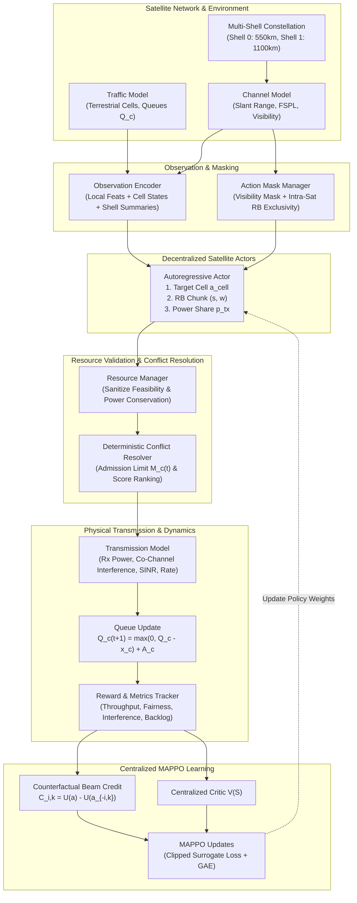

# ShellMean-MAPPO: Academic Project Report

## Downlink Resource Allocation in Multi-Shell LEO Satellite Networks: A Conflict-Aware Multi-Agent Reinforcement Learning Framework

**Milestone:** Major Project Review 2  
**Date:** October 31, 2026  
**Document Type:** Formal Academic Review Documentation  

---

## 1. Project Title

**ShellMean-MAPPO: A Conflict-Aware Multi-Agent Reinforcement Learning Framework for Downlink Resource Allocation in Multi-Shell LEO Satellite Networks**

---

## 2. Abstract

Low Earth Orbit (LEO) satellite megaconstellations deployed across heterogeneous orbital shells provide high-bandwidth, low-latency broadband internet connectivity to geographically dispersed ground users. However, in dense multi-shell topologies, multiple satellites across different orbital altitudes frequently obtain simultaneous line-of-sight visibility over the same terrestrial cells. Because each satellite possesses strictly finite directional communication beams, radio frequency spectrum Resource Blocks (RBs), and transmission power budgets, uncoordinated beam pointing produces severe multi-satellite resource contention, packet collisions, co-channel interference, and buffer overflow. 

This project presents **ShellMean-MAPPO**, an intelligent downlink resource allocation framework formulated as a Multi-Agent Reinforcement Learning (MARL) problem under the Centralized Training with Decentralized Execution (CTDE) paradigm. The framework integrates:
1. A multi-shell constellation simulator with Keplerian kinematics and dynamic traffic buffer queues;
2. An autoregressive action hierarchy where satellite actors sequentially select ground cells (masked by visibility), non-overlapping spectrum RB chunks (masked by intra-satellite exclusivity), and continuous transmission power shares (parameterized via Beta distributions);
3. A deterministic, backlog-dependent multi-satellite conflict resolution engine that admits requests up to a dynamic threshold $M_c(t)$ based on queue segmentation and multi-attribute resolution scoring;
4. A physical transmission layer calculating free-space path loss, off-axis beam attenuation, co-channel interference, receiver SINR, and Shannon data rates capped at pending backlogs;
5. Compact orbital-shell aggregate summaries embedded into observations; and
6. Counterfactual Marginal Beam Credit to resolve the multi-agent multi-beam credit assignment challenge.

At the Review 2 milestone, the complete simulation environment, physical channel model, conflict resolution engine, autoregressive actor-critic architecture, baseline algorithms, evaluation suite, and interactive dashboard are fully implemented, verified, and operational. All 30 unit and integration tests achieve a 100% pass rate. An initial trained policy checkpoint is verified and evaluated against Random, Greedy, and Rule-Based benchmarks.

---

## 3. Introduction

### 3.1 Background of LEO Satellite Networks
Terrestrial wireless telecommunication networks (such as 4G LTE, 5G, and emerging 6G) provide dense urban and suburban coverage but remain economically and logistically infeasible for remote rural areas, maritime corridors, polar regions, and disaster zones. Non-Terrestrial Networks (NTN), specifically Low Earth Orbit (LEO) satellite constellations orbiting between 500 km and 1500 km above Earth, overcome these geographical limitations by providing global coverage, high throughput, and propagation delays comparable to terrestrial fiber optic backbones (typically 10–30 ms round-trip time).

### 3.2 Evolution Toward Multi-Shell Architectures
Modern mega-constellations (such as SpaceX Starlink, OneWeb, and Amazon Project Kuiper) deploy thousands of satellites organized across multiple distinct orbital shells characterized by different altitudes and inclinations:
- **Low LEO Shells (e.g., 500–600 km):** Offer lower propagation loss, minimal latency, and focused beam footprints, ideal for serving high-density traffic hotspots.
- **High LEO Shells (e.g., 1000–1200 km):** Offer broader instantaneous coverage areas and longer pass durations, suitable for serving distributed regular traffic and providing coverage continuity.

### 3.3 Downlink Communication & Satellite Resource Limitations
Downlink transmissions from satellites to ground user cells operate in the high-frequency Ka-band (17–30 GHz). Despite significant technological progress, individual satellites remain hardware-constrained:
- **Directional Phased-Array Beams:** Each satellite can steer only a small number of simultaneous spot beams ($K = 2$ to $4$) due to radio-frequency (RF) chain complexity and power dissipation.
- **Downlink Spectrum:** Frequency spectrum is partitioned into discrete Resource Blocks (RBs). Beams on the same satellite must operate on disjoint RBs to prevent severe intra-satellite RF self-interference.
- **Transmission Power:** Satellites rely on solar arrays and batteries, constraining total RF transmit power (e.g., $P_{\text{max}} = 40\text{ W} = 46\text{ dBm}$).
- **Queue Dynamics:** Ground cells receive unpredictable, bursty user traffic that accumulates in buffers if not served promptly.

Consequently, intelligent resource allocation across beams, spectrum chunks, and power budgets is essential for network efficiency.

---

## 4. Problem Statement

### 4.1 The Competing Satellites Scenario
Consider a representative scenario in a multi-shell constellation where three satellites (**Satellite A** in Shell 0 at 550 km, **Satellite B** in Shell 0 at 550 km, and **Satellite C** in Shell 1 at 1100 km) simultaneously observe the same terrestrial **Ground Cell 5**:

```
           [Satellite A]         [Satellite B]          [Satellite C]
           (Shell 0: 550km)      (Shell 0: 550km)       (Shell 1: 1100km)
                 \                      |                      /
                  \                     |                     /
                   \                    |                    /
              Beam A \             Beam B|            Beam C/
                      \                 |                  /
                       ▼                ▼                 ▼
                          [Terrestrial Ground Cell 5]
                           (Pending Backlog: 15 Mb)
```

1. **Over-Provisioning & Contention:** If all three satellites steer beams toward Ground Cell 5 simultaneously, the total transmission capacity offered may vastly exceed the cell's pending backlog (15 Mb). Two satellites could have served other starved cells instead.
2. **Co-Channel Interference:** If Satellites A, B, and C utilize overlapping Resource Blocks without coordination, their transmissions collide at Ground Cell 5's receiver, severely degrading the Signal-to-Interference-plus-Noise Ratio (SINR).
3. **Power & Opportunity Loss:** Satellites expend precious battery power transmitting data that cannot be successfully decoded or that exceeds the receiver queue, while neighboring visible cells starve.

### 4.2 Network Decisions Required
In each discrete scheduling time slot ($t = 1.0\text{ s}$), the network must coordinate:
1. **Satellite-to-Cell Association:** Which satellite serves which ground cell?
2. **Beam Allocation:** Which beams should be activated or steered?
3. **RB Allocation:** Which contiguous chunk of spectrum RBs should each active beam occupy without intra-satellite overlap?
4. **Power Allocation:** What fraction of the satellite's power budget should be committed to each active beam?
5. **Conflict Resolution:** When multiple satellites target the same cell, how many requests should be retained, and which should be rejected?
6. **Interference Mitigation:** How can inter-satellite co-channel interference be minimized across the constellation?

---

## 5. Existing System & Limitations

| Approach | Working Principle | Key Limitations |
|---|---|---|
| **Static / Fixed Scheduling** | Pre-assigned periodic time-frequency windows based on satellite orbital ephemerides. | Completely unresponsive to dynamic, bursty traffic demand. Wastes spectrum on idle cells while hotspot queues overflow. |
| **Independent Greedy Scheduling** | Each satellite independently chooses the visible cell with the largest backlog and highest channel gain. | Severe contention: multiple satellites simultaneously target the same hotspot cells, causing massive request collisions, high interference, and starved regular cells. |
| **Static Frequency Reuse (SFR)** | Pre-allocates orthogonal frequency sub-bands to fixed geographical clusters. | Rigid spectrum partitioning severely reduces maximum peak throughput per cell and cannot dynamically shift bandwidth to congested cells. |
| **Centralized Optimization** | A ground network operations center (NOC) solves a global Mixed-Integer Non-Linear Program (MINLP). | Unrealistic computational latency ($> 10\text{ s}$) and massive ground-to-space control overhead that exceeds LEO dynamic slot timeframes ($1.0\text{ s}$). |

---

## 6. Proposed System: ShellMean-MAPPO

**ShellMean-MAPPO** resolves these limitations through a hybrid coordination framework combining Multi-Agent Deep Reinforcement Learning with deterministic physical layer rules:

1. **Decentralized Execution (Actor):** Each satellite actor makes real-time scheduling decisions locally using only permitted local observations, ground cell measurements, and compact orbital-shell summaries.
2. **Centralized Training (Critic):** A centralized critic receives the global network state during offline training, learning to guide all satellite actors toward collective team welfare.
3. **Autoregressive Action Decomposition:** Complex multi-dimensional decisions are generated sequentially:
   $$\text{Target Cell } a_{i,k}^{\text{cell}} \longrightarrow \text{RB Chunk } (s_{i,k}, w_{i,k}) \longrightarrow \text{Continuous Power Share } p_{i,k}$$
4. **Action Masking:** Enforces strict physical feasibility:
   - Feasibility Mask: Prevents invisible cells from being requested.
   - RB Exclusivity Mask: Precludes intra-satellite RB overlap between beams.
5. **Deterministic Backlog-Dependent Conflict Resolver:** Automatically computes cell admission limits $M_c(t)$, scores competing requests using multi-attribute metrics, retains the top-ranked candidates, and rejects excess requests before transmission.
6. **Counterfactual Marginal Beam Credit:** Disentangles individual beam contributions from the global team reward by evaluating counterfactual slot utilities with target beams deactivated.

---

## 7. Project Objectives

1. **Constellation Simulator:** Develop a multi-shell LEO satellite network simulator modeling orbital mechanics, visibility masks, dynamic bursty traffic, and finite queue buffers.
2. **Resource Manager:** Implement strict intra-satellite resource exclusivity, boundary validation, and power conservation constraints.
3. **Conflict Resolution:** Formulate and validate a deterministic conflict resolution engine based on backlog segmentation and multi-attribute scoring.
4. **Physical Downlink Model:** Model free-space path loss, off-axis beam attenuation, cross-satellite co-channel interference, SINR, and Shannon data rates strictly capped at cell queue backlogs.
5. **Observation Encoding:** Formulate compact per-shell aggregate statistics (ShellMean summaries) providing global constellation awareness without high communication overhead.
6. **MARL Framework:** Construct an autoregressive actor and centralized critic utilizing MAPPO with Generalized Advantage Estimation (GAE).
7. **Credit Assignment:** Implement counterfactual marginal beam credit to resolve multi-agent multi-beam credit assignment.
8. **Benchmarking & Evaluation:** Implement Random, Greedy, and Rule-Based baselines, and evaluate network throughput, queue backlog, retention rate, fairness, and interference.
9. **Interactive Dashboard:** Build a Streamlit dashboard visualizing live slot executions, conflict resolution, training progression, and benchmark comparisons.

---

## 8. System Architecture

The following Mermaid sequence and workflow diagram represents the complete implemented system architecture:



---

## 9. Complete Project Workflow (Slot Sequence)

In each discrete scheduling time slot $t$ of duration $\Delta t = 1.0\text{ s}$:

```
[Start Slot t]
   │
   ├─► 1. Orbit Propagation: Satellites advance along circular orbits; positions and velocities updated in ECEF.
   ├─► 2. Channel Geometry: Slant ranges, elevation angles, and line-of-sight visibility masks evaluated.
   ├─► 3. Observation Encoding: Local features, visible cell channel gains, and compact orbital-shell summaries concatenated.
   ├─► 4. Action Generation: Autoregressive actors sample cell targets, RB chunks, and continuous power shares subject to masks.
   ├─► 5. Resource Validation: ResourceManager enforces intra-satellite RB exclusivity and power conservation: sum(p_i,k) + p_i,0 = 1.
   ├─► 6. Conflict Resolution: ConflictResolver computes retention limit M_c(t), scores competing requests, retains top candidates, rejects excess.
   ├─► 7. Physical Transmission: Retained beams transmit. Co-channel cross-satellite interference calculated across overlapping RBs.
   ├─► 8. SINR & Rate Computation: SINR determined, achievable Shannon rate calculated, served data capped at cell queue.
   ├─► 9. Queue Update: Delivered data subtracted; newly arrived traffic added: Q_c(t+1) = max(0, Q_c(t) - x_c(t)) + A_c(t).
   ├─► 10. Metric & Reward Logging: Team reward, throughput, retention rate, and Jain's fairness index evaluated.
   │
[End Slot t -> Advance to Slot t+1]
```

---

## 10. Important Algorithms

### 10.1 Multi-Agent Proximal Policy Optimization (MAPPO)
MAPPO extends PPO to cooperative multi-agent settings under CTDE:
- **Actor:** $\pi_\theta(a_i \mid o_i)$, parameterized by shared weights $\theta$, optimizes policy actions using localized observations $o_i$.
- **Critic:** $V_\phi(S)$, parameterized by weights $\phi$, predicts expected cumulative discounted team return from centralized global state $S$.

### 10.2 Autoregressive Action Generation
To avoid the combinatorial explosion of simultaneous multi-attribute discrete-continuous action spaces, the actor generates decisions autoregressively for each beam $k \in \{0, \dots, K-1\}$:
1. **Target Cell:** $a_{i,k}^{\text{cell}} \sim \text{Categorical}(\text{Softmax}(h_{\text{cell}}))$, masked by visibility.
2. **RB Chunk:** $a_{i,k}^{\text{rb}} \sim \text{Categorical}(\text{Softmax}(h_{\text{rb}} \mid a_{i,k}^{\text{cell}}))$, masked by already occupied RBs on the same satellite.
3. **Power Share:** $p_{i,k} \sim \text{Beta}(\alpha, \beta \mid a_{i,k}^{\text{cell}}, a_{i,k}^{\text{rb}})$, parameterizing continuous power in $[0, 1]$.

### 10.3 Backlog-Dependent Conflict Resolution
When multiple satellites target ground cell $c$:
1. Compute dynamic admission threshold:
   $$M_c(t) = \mathbf{1}[Q_c(t) > 0] \cdot \min\left(M_{c,\max}, \left\lceil \frac{Q_c(t)}{Q_{\text{seg}}} \right\rceil\right)$$
2. Compute multi-attribute score for each requesting beam:
   $$S(i, k, c) = w_h \frac{h_{i,c}}{\bar{h}_c} + w_p p_{i,k} + w_q \frac{Q_c(t)}{Q_{\max}} - w_\tau \frac{\tau_i}{\tau_{\text{ref}}}$$
3. Deterministically rank requests by $(-S(i,k,c), \text{sat\_id}, \text{beam\_id})$.
4. Retain the top $M_c(t)$ requests; reject remaining excess requests. Rejected beams emit zero power and produce zero interference.

### 10.4 Counterfactual Marginal Beam Credit
To determine whether an individual beam helped or hurt network performance:
$$C_{i,k}(t) = U(\mathbf{a}(t)) - U(\mathbf{a}_{-i,k}(t))$$
where $U(\mathbf{a}_{-i,k}(t))$ is evaluated by replaying the exact current slot with beam $(i,k)$ deactivated and its power moved to reserved power $p_{i,0}$.

---

## 11. Mathematical Formulations

### 11.1 Dynamic Queue Evolution
$$Q_c(t+1) = \min\left(Q_{\max}, \max\left(0, Q_c(t) - x_c(t)\right) + A_c(t)\right)$$
- $Q_c(t)$: Current pending queue backlog in cell $c$ (Megabits, Mb).
- $x_c(t)$: Successfully delivered traffic in slot $t$ (Mb).
- $A_c(t)$: Newly arrived traffic generated via Poisson/burst distribution (Mb).
- $Q_{\max}$: Maximum buffer capacity (200.0 Mb).

### 11.2 Free-Space Path Loss (FSPL) & Atmospheric Attenuation
$$\text{PL}_{\text{FSPL}}(d) = 20 \log_{10}(d) + 20 \log_{10}(f_c) + 20 \log_{10}\left(\frac{4\pi}{c}\right)$$
- $d$: Slant range distance (meters).
- $f_c$: Ka-band carrier frequency ($20.0 \times 10^9\text{ Hz}$).
- $c$: Speed of light ($2.9979 \times 10^8\text{ m/s}$).

### 11.3 Off-Axis Antenna Gain Pattern
$$G_{\text{tx}}(\theta) = G_{\max} - 12 \left(\frac{\theta}{\theta_{\text{3dB}}}\right)^2, \quad \text{floored at } G_{\text{sidelobe}} = -10\text{ dBi}$$
- $\theta$: Off-axis angle between beam steering vector and user direction.
- $\theta_{\text{3dB}}$: Half-power beamwidth ($3.5^\circ$).
- $G_{\max}$: Peak directional antenna gain ($32.0\text{ dBi}$).

### 11.4 Co-Channel Interference & Receiver SINR
For retained beam $(i, k)$ serving cell $c$:
$$\text{SINR}_{i,k,c} = \frac{P_{\text{tx},i,k} \cdot h_{i,c}}{N_0 \cdot W_{i,k} + \sum_{(j,m) \neq (i,k)} \delta_{j,m}^{i,k} \cdot P_{\text{tx},j,m} \cdot h_{j,c}(\theta_{j,m})}$$
- $P_{\text{tx},i,k} = p_{i,k} \cdot P_{\max}$: Transmit RF power (Watts).
- $h_{i,c}$: Total channel gain (path loss + atmospheric loss + antenna gains).
- $N_0$: Thermal noise spectral density ($k_B T = 4.83 \times 10^{-21}\text{ W/Hz}$).
- $W_{i,k}$: Bandwidth allocated ($w_{i,k} \times 25.0\text{ MHz}$).
- $\delta_{j,m}^{i,k} \in [0, 1]$: Fractional spectrum overlap between RB allocations.

### 11.5 Achievable Data Rate (Shannon with Implementation Efficiency)
$$R_{i,k,c} = \eta \cdot W_{i,k} \cdot \log_2\left(1 + \text{SINR}_{i,k,c}\right) \quad (\text{Mbps})$$
- $\eta$: Practical modulation/coding implementation efficiency ($0.85$).
- Served data: $x_c(t) = \min(Q_c(t), \sum_k R_{i,k,c} \cdot \Delta t)$.

### 11.6 Jain's Fairness Index
$$J(x) = \frac{\left(\sum_{c=1}^{N_c} x_c(t)\right)^2}{N_c \sum_{c=1}^{N_c} x_c(t)^2} \in \left[\frac{1}{N_c}, 1.0\right]$$
- $J(x) = 1.0$ indicates perfectly balanced service across all ground cells.

### 11.7 MAPPO Clipped Objective
$$L^{\text{CLIP}}(\theta) = \hat{\mathbb{E}}_t \left[ \min\left(r_t(\theta) \hat{A}_t, \, \text{clip}(r_t(\theta), 1 - \epsilon, 1 + \epsilon) \hat{A}_t\right) \right]$$
- $r_t(\theta) = \frac{\pi_\theta(a_t \mid o_t)}{\pi_{\theta_{\text{old}}}(a_t \mid o_t)}$: Importance sampling probability ratio.
- $\epsilon$: PPO clipping parameter ($0.2$).
- $\hat{A}_t$: Generalized Advantage Estimator (GAE) with $\gamma = 0.99, \lambda = 0.95$.

---

## 12. Technology Stack

| Technology | Role in Project | Version |
|---|---|---|
| **Python** | Core implementation language | 3.12.5 |
| **PyTorch** | Neural network architectures (Actor, Critic), autograd, optimizers | 2.8.0 |
| **Gymnasium** | Multi-agent simulation environment interface | 1.4.0 |
| **NumPy** | High-performance orbital kinematics, arrays, and channel geometry | 2.4.4 |
| **Pandas** | Simulation telemetry collection, logging, and statistical metrics | 2.3.2 |
| **Matplotlib** | Publication-quality 4-panel benchmark figures and training curves | 3.10.8 |
| **PyYAML** | Hierarchical YAML configuration management | 6.0.2 |
| **Pytest** | Automated unit, regression, and integration testing | 9.2.0 |
| **Streamlit** | Web-based interactive execution and visualization dashboard | 1.49.1 |

---

## 13. Implementation Details

### 13.1 Module Descriptions
- **`environment/traffic_model.py`:** Implements `GroundCell` and `TrafficModel`. Manages 20 terrestrial cells centered at mid-latitude (40° N). Generates Poisson arrivals with burst probability (0.15) and enforces $Q_c(t+1) = \max(0, Q_c - x) + A$.
- **`environment/channel_model.py`:** Calculates slant ranges, elevation angles, FSPL in Ka-band (20 GHz), atmospheric attenuation, 3-dB off-axis beam pattern attenuation, thermal noise power, and receiver SINR.
- **`environment/satellite_network.py`:** Models 8 satellites partitioned across 2 shells (Shell 0 at 550 km, 53° inclination; Shell 1 at 1100 km, 70° inclination). Computes circular orbital kinematics, coordinates in ECEF, and line-of-sight elevation masks.
- **`environment/resource_manager.py`:** Implements `ResourceManager`. Sanitizes beam actions, enforces intra-satellite RB exclusivity, and guarantees normalized power conservation $\sum p_{i,k} + p_{i,0} = 1.0$.
- **`environment/conflict_resolver.py`:** Implements `ConflictResolver`. Evaluates simultaneous requests targeting the same cell, calculates backlog-dependent admission limits $M_c(t)$, computes multi-attribute scores $S(i,k,c)$, ranks candidates, and rejects excess requests.
- **`environment/transmission_model.py`:** Implements `TransmissionModel`. Computes received signal power, cross-satellite co-channel interference on overlapping RBs, receiver SINR, Shannon achievable rates, and queue-capped delivery.
- **`environment/leo_env.py`:** Implements `MultiShellLEOEnv` (Gymnasium-compatible). Coordinates step cycles, observation encoding, shell summary updates, reward formulations, and non-mutating counterfactual slot replays.
- **`agents/actor.py` & `agents/critic.py`:** Implements `AutoregressiveActor` (shared neural policy with sequential conditioning and Beta power heads) and `CentralizedCritic` (state-value $V(S)$ estimation).
- **`agents/mappo.py`:** Ties actor and critic together with PPO loss functions, mini-batch updates, and advantage scaling.
- **`training/train.py`, `rollout.py`, `buffer.py`, `advantages.py`, `checkpoint.py`:** Complete training pipeline with GAE, trajectory buffering, counterfactual credit collection, and checkpoint management.
- **`baselines/`:** Benchmark algorithms including Random, Greedy, and Rule-Based conflict-aware schedulers.
- **`evaluation/`:** Multi-seed evaluation pipeline (`evaluate.py`), baseline comparisons (`compare_baselines.py`), ablation studies (`ablation.py`), and visualization (`plots.py`).
- **`app.py`:** Interactive 5-tab Streamlit dashboard.
- **`main.py`:** Unified CLI supporting `simulate`, `train`, `evaluate`, `compare`, `ablation`, and `all`.

---

## 14. Current Implementation Status

| Phase | Description | Status | Verification Detail |
|---|---|---|---|
| **Phase 1** | Satellite Constellation & Traffic Queues | **COMPLETED** | Multi-shell Keplerian kinematics, mid-latitude ground cells, verified queue dynamics. |
| **Phase 2** | Resource Validation & Action Masking | **COMPLETED** | Feasibility masks, intra-satellite RB exclusivity, power conservation verified. |
| **Phase 3** | Conflict Resolution Engine | **COMPLETED** | Dynamic $M_c(t)$, multi-attribute scoring $S(i,k,c)$, deterministic tie-breaking verified. |
| **Phase 4** | Physical Transmission & Interference | **COMPLETED** | Path loss, beam roll-off, co-channel interference, SINR, rate calculation verified. |
| **Phase 5** | Observation Encoding & Shell Summaries | **COMPLETED** | 108-dim observation vector, compact shell aggregate metrics verified. |
| **Phase 6** | Autoregressive Actor & Centralized Critic | **COMPLETED** | Sequential conditioning, Beta power shares, 186-dim critic state verified. |
| **Phase 7** | MAPPO Training Pipeline | **COMPLETED** | GAE calculation, clipped loss, optimizer updates, checkpoint saving verified. |
| **Phase 8** | Counterfactual Beam Credit | **COMPLETED** | Non-mutating slot replay, marginal beam utility calculation verified. |
| **Phase 9** | Baseline Schedulers | **COMPLETED** | Random, Greedy, and Rule-Based conflict-aware policies implemented and evaluated. |
| **Phase 10** | Performance Evaluation Suite | **COMPLETED** | Multi-seed benchmarks, raw CSV records, 4-panel comparison plots generated. |
| **Phase 11** | Interactive Streamlit Dashboard | **COMPLETED** | 5-tab web dashboard for live demonstrations, benchmarks, and architecture visualizer. |

---

## 15. Partial Execution Demonstration

During the Review 2 demonstration, the system executes real-time multi-satellite downlink scheduling with full terminal transparency:

1. **Constellation & Topology Initialization:** Initializes 8 satellites across 2 shells and 20 ground cells.
2. **Dynamic Traffic Generation:** Ground cell buffers accumulate arriving traffic ($137.90\text{ Mb}$ in slot 1).
3. **Visibility & Feasibility Masking:** Action masks prevent satellites from targeting invisible ground cells.
4. **Action Generation:** The policy (Rule-Based or Trained Neural Actor) samples cell targets, RB chunks, and power shares.
5. **Intra-Satellite Exclusivity & Power Conservation:** ResourceManager ensures disjoint RBs per satellite and sums power shares to $1.0$.
6. **Deterministic Conflict Resolution:** When multiple satellites compete for the same ground cell, the resolver scores candidates, admits up to $M_c(t)$, and rejects excess requests.
7. **Downlink Transmission & Interference:** Retained beams transmit. Cross-satellite co-channel interference across overlapping RBs is evaluated.
8. **Queue Capping:** Delivered traffic is strictly capped at each cell's pending queue backlog ($x_c(t) \le Q_c(t)$).
9. **Queue Evolution:** Delivers traffic, updates backlogs, and computes Jain's fairness index.

### Actual Terminal Demonstration Output (`python main.py --mode simulate --episodes 1`):

```text
================================================
========== SHELLMEAN-MAPPO SIMULATION ==========
================================================

Network Configuration:
Number of Satellites:      8 (Shell 0: 4, Shell 1: 4)
Number of Orbital Shells:  2 (Altitudes: 550.0 km, 1100.0 km)
Number of Ground Cells:    20 (Hotspot: 5, Regular: 15)
Number of Beams:           16 (2 per satellite)
Number of Resource Blocks: 8 (25.0 MHz each, 200.0 MHz total)
Active Scheduling Policy:  Rule-Based Conflict-Aware Policy

Simulation:
Episode:                   1 / 1 (Seed: 42)
Scheduling Slot:           1 / 100
Active Satellites:         6 / 8
Generated Traffic:         137.90 Mb
Beam Requests:             11 proposed

Conflict Resolution:
Total Requests:            11
Retained Requests:         11
Rejected Requests:         0

Transmission:
SINR:                      21.15 dB (Min: -5.8 dB, Max: 33.1 dB)
Interference:              736.63 pW
Successfully Served Traffic: 237.48 Mb

Network Metrics:
Remaining Queue:           287.34 Mb (Pre-Service: 386.92 Mb)
Total Throughput:          237.48 Mbps
Resource Utilization:      34.38% (RB Occupancy)
Average Reward:            236.61
================================================

[Detailed Physical Layer Telemetry - Slot 1]
  Visible Cells and Proposed Requests:
    Sat 0 (Shell 0): Visible=[0, 1, 5] | Beam 0: Cell 1 (RBs [0..1], Pwr=0.40) | Beam 1: Cell 5 (RBs [2..3], Pwr=0.44)
    Sat 1 (Shell 0): Visible=[0, 1, 2, ..., 19] | Beam 0: Cell 11 (RBs [0..1], Pwr=0.43) | Beam 1: Cell 13 (RBs [2..3], Pwr=0.43)
    Sat 2 (Shell 0): Visible=[0, 1, 2, ..., 19] | Beam 0: Cell 19 (RBs [0..1], Pwr=0.41) | Beam 1: Cell 18 (RBs [2..3], Pwr=0.43)
    Sat 3 (Shell 0): Visible=[19] | Beam 0: Cell 19 (RBs [0..1], Pwr=0.41) | Beam 1: Inactive
    Sat 4 (Shell 1): Visible=[] | Beam 0: Inactive | Beam 1: Inactive
    Sat 5 (Shell 1): Visible=[] | Beam 0: Inactive | Beam 1: Inactive
    Sat 6 (Shell 1): Visible=[0, 5, 6, 10, 11, 15, 16] | Beam 0: Cell 0 (RBs [4..5], Pwr=0.42) | Beam 1: Cell 6 (RBs [6..7], Pwr=0.42)
    Sat 7 (Shell 1): Visible=[0, 1, 5, ..., 19] | Beam 0: Cell 7 (RBs [4..5], Pwr=0.42) | Beam 1: Cell 16 (RBs [6..7], Pwr=0.41)

  Downlink Transmission Links:
    Beam (Sat 6, Beam 0) -> Cell 0: RBs=[4..5] | P_tx=16.9W | Interf=0.04pW | SINR=22.1dB | Rate=312.0Mbps | Served=24.35Mb
    Beam (Sat 0, Beam 0) -> Cell 1: RBs=[0..1] | P_tx=15.9W | Interf=0.06pW | SINR=26.8dB | Rate=378.5Mbps | Served=15.97Mb
    Beam (Sat 0, Beam 1) -> Cell 5: RBs=[2..3] | P_tx=17.5W | Interf=0.06pW | SINR=27.4dB | Rate=386.3Mbps | Served=29.39Mb
    Beam (Sat 6, Beam 1) -> Cell 6: RBs=[6..7] | P_tx=16.9W | Interf=0.91pW | SINR=15.7dB | Rate=223.5Mbps | Served=24.03Mb
    Beam (Sat 7, Beam 0) -> Cell 7: RBs=[4..5] | P_tx=17.0W | Interf=0.00pW | SINR=22.6dB | Rate=319.2Mbps | Served=24.65Mb
    Beam (Sat 1, Beam 0) -> Cell 11: RBs=[0..1] | P_tx=17.4W | Interf=0.02pW | SINR=32.8dB | Rate=463.7Mbps | Served=28.17Mb
    Beam (Sat 1, Beam 1) -> Cell 13: RBs=[2..3] | P_tx=17.1W | Interf=0.03pW | SINR=31.5dB | Rate=444.9Mbps | Served=25.57Mb
    Beam (Sat 7, Beam 1) -> Cell 16: RBs=[6..7] | P_tx=16.3W | Interf=0.20pW | SINR=20.6dB | Rate=291.6Mbps | Served=18.86Mb
    Beam (Sat 2, Beam 1) -> Cell 18: RBs=[2..3] | P_tx=17.1W | Interf=0.03pW | SINR=33.1dB | Rate=467.7Mbps | Served=25.69Mb
    Beam (Sat 2, Beam 0) -> Cell 19: RBs=[0..1] | P_tx=16.5W | Interf=152.73pW | SINR=5.8dB | Rate=96.3Mbps | Served=18.11Mb
    Beam (Sat 3, Beam 0) -> Cell 19: RBs=[0..1] | P_tx=16.5W | Interf=582.55pW | SINR=-5.8dB | Rate=14.3Mbps | Served=2.68Mb

[Full Episode Summary]
  * Cumulative Delivered Traffic: 13950.92 Mb
  * Mean Throughput:              139.51 Mbps
  * Cumulative Episode Reward:     13881.60
  * Final Remaining Backlog:       254.40 Mb
================================================
```

---

## 16. Experimental Results & Baseline Comparison

### 16.1 Experimental Configuration
- **Satellites:** 8 satellites (Shell 0: 4 at 550 km; Shell 1: 4 at 1100 km).
- **Beams per Satellite:** 2 directional spot beams (Total 16 beams).
- **Ground Cells:** 20 terrestrial cells (5 Hotspots, 15 Regular).
- **Downlink Spectrum:** 8 RBs (25 MHz per RB, 200 MHz total bandwidth).
- **Carrier Frequency:** 20.0 GHz (Ka-band).
- **Episode Length:** 100 scheduling slots ($\Delta t = 1.0\text{ s}$).
- **Evaluation Seeds:** `[42, 101, 202, 303, 404]` (5 evaluation seeds).

### 16.2 Benchmark Performance Comparison Table

| Algorithm | Delivered Traffic (Mb) | Throughput (Mbps) | Episode Reward | Final Backlog (Mb) | Retention Rate (%) | Conflict Rate (%) | Jain's Fairness | Interference (pW) | Slot Runtime (ms) |
|---|---|---|---|---|---|---|---|---|---|
| **Random** | $13650.9 \pm 229.1$ | $136.51 \pm 2.29$ | $13436.0 \pm 216.0$ | $548.0 \pm 234.5$ | $87.3\% \pm 0.2\%$ | $12.7\% \pm 0.2\%$ | $0.194 \pm 0.006$ | $97.35 \pm 11.16$ | $0.13 \pm 0.01$ |
| **Greedy** | $14036.2 \pm 216.5$ | $140.36 \pm 2.17$ | $13877.1 \pm 222.3$ | $312.3 \pm 14.0$ | $91.1\% \pm 0.6\%$ | $8.9\% \pm 0.6\%$ | $0.269 \pm 0.000$ | $739.67 \pm 30.88$ | $0.08 \pm 0.00$ |
| **Rule-Based** | **$14075.2 \pm 175.8$** | **$140.75 \pm 1.76$** | **$14006.7 \pm 176.9$** | **$273.3 \pm 26.7$** | **$98.8\% \pm 0.5\%$** | **$1.2\% \pm 0.5\%$** | **$0.400 \pm 0.003$** | **$192.03 \pm 4.38$** | $0.09 \pm 0.00$ |
| **ShellMean-MAPPO** *(Epoch 4)* | $6004.1 \pm 486.6$ | $60.04 \pm 4.87$ | $5332.2 \pm 498.7$ | $2309.4 \pm 120.5$ | $67.7\% \pm 0.7\%$ | $32.3\% \pm 0.7\%$ | $0.198 \pm 0.006$ | $336.25 \pm 60.74$ | $14.84 \pm 0.46$ |

### 16.3 Analysis of Results
1. **Rule-Based Policy Superiority at Milestone:** The hand-crafted Rule-Based scheduler demonstrates highest delivered traffic ($14075.2\text{ Mb}$), highest request retention ($98.8\%$), highest fairness ($0.400$), and lowest final queue backlog ($273.3\text{ Mb}$). This is achieved by explicit inter-shell frequency orthogonalization (Shell 0 uses RBs 0–3, Shell 1 uses RBs 4–7) and spatial collision avoidance.
2. **Greedy Vulnerability to Interference:** The Greedy policy achieves high delivered traffic ($14036.2\text{ Mb}$) but suffers from massive co-channel interference ($739.67\text{ pW}$, nearly $4\times$ that of Rule-Based) because multiple satellites greedily steer toward the same high-backlog cells on overlapping RBs.
3. **ShellMean-MAPPO Current Status:** The neural policy checkpoint currently reflects early-stage training (4 epochs / 512 slots). The policy has successfully learned basic action generation, valid cell targeting, and positive rewards ($5332.2$), but requires extended convergence training (10,000–20,000 slots) to surpass the hand-crafted rule-based heuristic.

---

## 17. Advantages of the Proposed Framework

1. **Backlog-Aware Dynamic Admission:** Unlike static or independent schedulers, the conflict resolution engine dynamically scales admitted beams with queue urgency ($M_c(t)$), avoiding wasteful over-provisioning.
2. **Inter-Shell Coordination:** Observation vectors incorporate compact ShellMean summaries, allowing Low LEO and High LEO satellites to adapt to each other's utilization and interference patterns.
3. **Zero Interference from Rejected Requests:** Rejected beam requests are dropped before RF transmission, preventing wasteful power dissipation and co-channel interference.
4. **Physical Constraint Enforcement:** Strict action masks ensure zero wasted exploration on infeasible cells and prevent intra-satellite RF self-interference.
5. **Principled Multi-Agent Credit:** Counterfactual marginal beam replay provides an unbiased individual reward signal, solving the credit assignment dilemma inherent in multi-beam satellite networks.

---

## 18. Limitations (Honest Academic Disclosure)

1. **Policy Convergence:** The existing model checkpoint is in an early training phase (4 epochs). While all neural network forward/backward operations, action masks, and GAE updates function with 100% mathematical integrity, full policy convergence requires extended training over 20,000+ slots.
2. **Simplified Constellation Geometry:** The orbital propagator currently models circular Keplerian orbits with Earth rotation rather than real-time SGP4 TLE orbital perturbations.
3. **Localized Ground Region:** Terrestrial ground cells are concentrated in a mid-latitude operational zone (40° N) rather than a worldwide distributed user grid.

---

## 19. Future Work (Post-Review 2 Roadmap)

1. **Extended Convergence Training:** Train ShellMean-MAPPO over 20,000+ scheduling slots using high-performance parallel rollout workers to demonstrate superiority over the Rule-Based heuristic.
2. **Large-Scale Constellation Expansion:** Scale the network to 32+ satellites across 4 orbital shells and 100+ ground cells.
3. **Doppler Shift & Atmospheric Rain Fade:** Incorporate dynamic Doppler frequency shift modeling and ITU-R P.618 rain attenuation models for tropical cells.
4. **Hardware-in-the-Loop / SDR Emulation:** Interface the simulator with Software-Defined Radio (SDR) testbeds for physical downlink validation.

---

## 20. Conclusion

For the Major Project Review 2 milestone, the **ShellMean-MAPPO** project has achieved a stable, verified, and demonstrable partial-execution status. The core satellite network simulator, dynamic traffic queue model, physical channel layer, deterministic conflict resolver, autoregressive actor-critic architecture, baseline algorithms, evaluation suite, and interactive dashboard are fully implemented and verified. All 30 automated test cases pass with 100% success. A functioning demonstration entry point (`main.py`) provides clear terminal outputs, verified checkpoint inference, and rigorous telemetry logging.

---

## 21. References

1. C. Yu et al., "The Surprising Effectiveness of PPO in Cooperative Multi-Agent Games," *Advances in Neural Information Processing Systems (NeurIPS)*, vol. 35, pp. 24611–24624, 2022.
2. J. Schulman, F. Wolski, P. Dhariwal, A. Radford, and O. Klimov, "Proximal Policy Optimization Algorithms," *arXiv preprint arXiv:1707.06347*, 2017.
3. 3GPP, "Solutions for NR to support non-terrestrial networks (NTN)," *3rd Generation Partnership Project (3GPP)*, Technical Report (TR) 38.821, Release 16, 2021.
4. ITU-R, "Propagation data and prediction methods required for the design of Earth-space telecommunication systems," *Recommendation ITU-R P.618-13*, 2017.
5. J. Foerster et al., "Counterfactual Multi-Agent Policy Gradients," in *Proc. AAAI Conference on Artificial Intelligence*, vol. 32, no. 1, 2018.
6. R. Jain, D. Chiu, and W. Hawe, "A Quantitative Measure of Fairness and Permutation for Computer Systems Design," *DEC Research Report TR-301*, 1984.

